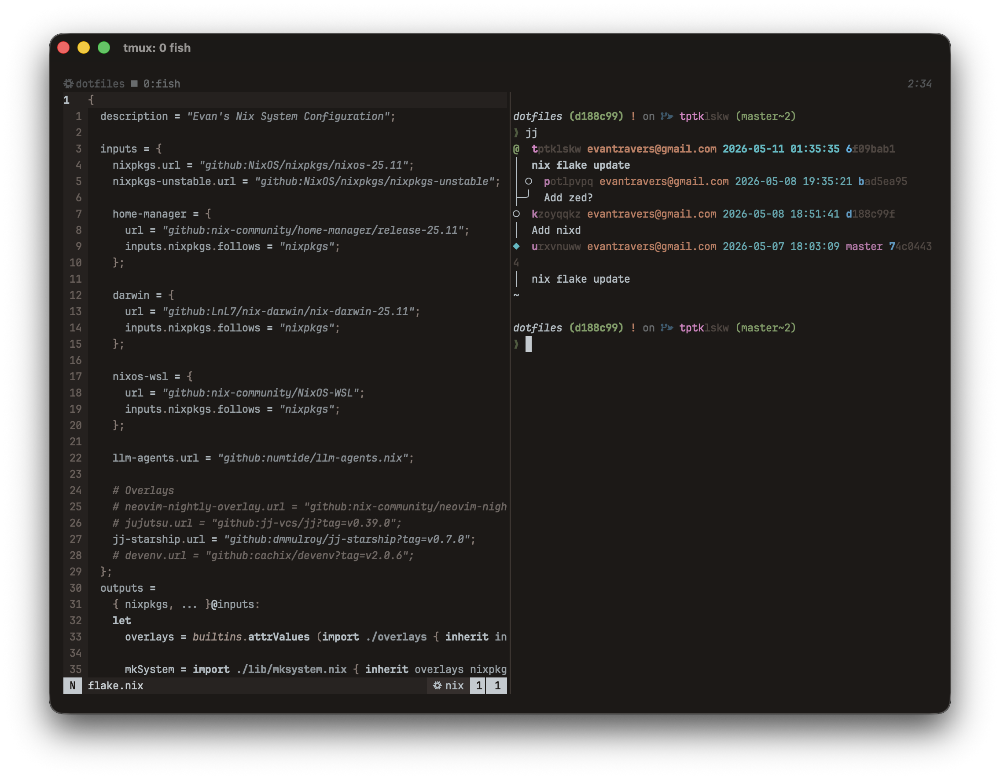

# Dotfiles

An opinionated setup about how I want my *nix development environment and host machines configured. Presently managed through nix.

## Development Environment

- Neovim, BTW
- tmux
- fish
- jujutsu

## OS Hosts

- OSX:
  - Hammerspoon
  - Kanata
  - Homebrew
  - Settings
- WSL:
  - interop
  - wezterm.terminfo
  - 1Password passthru

## Bootstrap

Install [Determinate Systems Installer](https://github.com/DeterminateSystems/nix-installer) or [WSL2 Nix](https://github.com/nix-community/NixOS-WSL)

WSL:
`sudo nixos-rebuild switch --flake github:evantravers/dotfiles#wsl`

Darwin:
- Install [homebrew](https://brew.sh/)
- `sudo nix run nix-darwin/nix-darwin-26.05#darwin-rebuild -- switch --flake github:evantravers/dotfiles#Theseus`

Use 1Password to configure SSH Agent for host

## Update

`nh` knows where this checkout lives, so from anywhere:

WSL:
`nh os switch`
OR
`sudo nixos-rebuild switch --flake .`

Darwin:
`nh darwin switch`
OR
`sudo darwin-rebuild switch --flake .`

## Development

- `nix fmt` formats every Nix file (same settings as `jj fix`)
- `nix build .#wt` / `nix build .#jjc` build the packages in `pkgs/` on their own

## References
- Mainly copying mitchellm's incredible work, especially mksystem.nix
